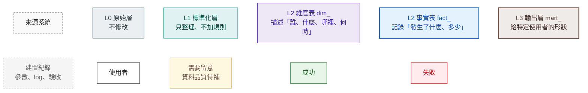
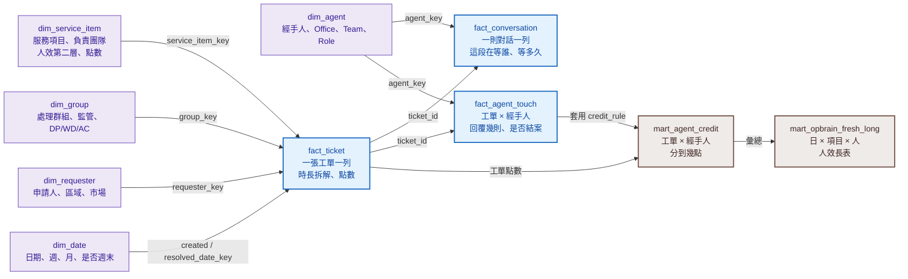
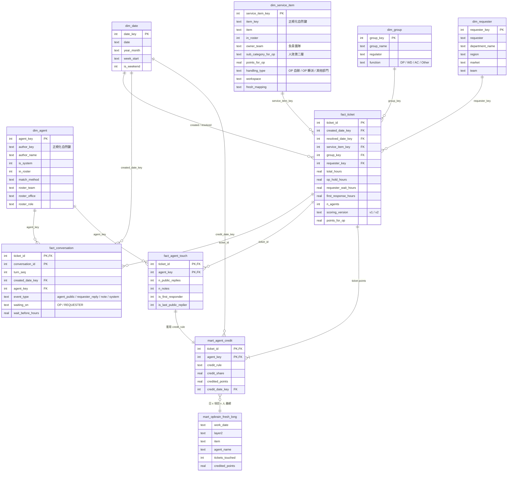
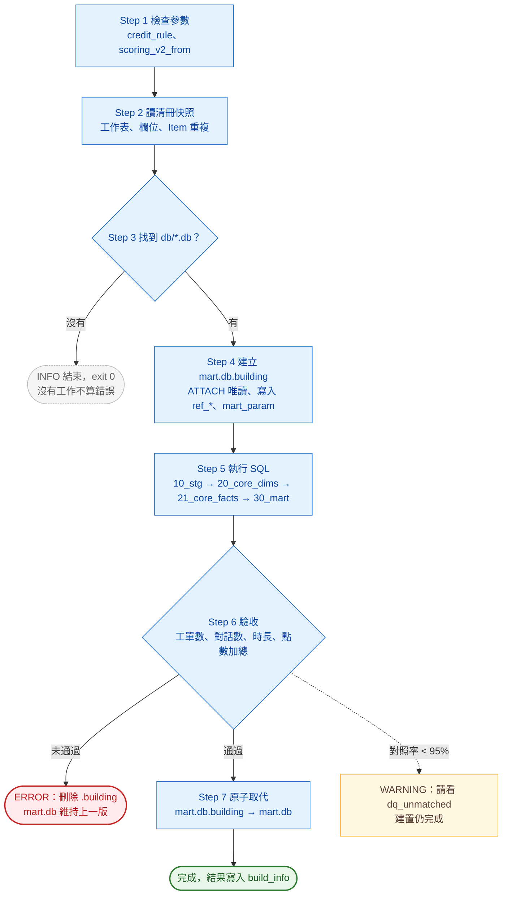

# Ticket Mart Architecture (工單 Mart 架構)

`mart_build.py` 把爬蟲寫入的年度 .db（唯讀）和人效項目清冊快照，全量重建成分層的 `mart/mart.db`。
本文件用四張圖說明：資料怎麼分層流動、表的分工、表與表怎麼關聯、一次建置怎麼執行。
文字說明與實測數字見 [README〈建置 Ticket Mart〉](../README.md)。

---

## 0. Color Legend (顏色圖例)

所有圖都使用同一組顏色。**每一層一種顏色**；紅、綠、黃只用在有語意的地方（失敗、成功、需要留意），不代表任何一層。



| 顏色 | 代表 | 第一次看可以這樣理解 |
|---|---|---|
| 灰（虛線框） | 來源系統 | 資料從哪裡來，不在 mart 裡 |
| 藍灰 | L0 原始層 | 爬蟲抓回來的原樣資料，mart 只讀不改 |
| 青綠 | L1 標準化層 | 把欄位整理乾淨，不加任何判斷 |
| 紫 | L2 維度表 `dim_` | 用來「切」資料的角度：服務項目、經手人、群組、申請人、日期 |
| 藍（粗框） | L2 事實表 `fact_` | 被「量」的東西：工單、對話、經手紀錄，以及時數、點數 |
| 棕（粗框） | L3 輸出層 `mart_` | 已經整理成某個使用者要的樣子，可以直接拿去用 |
| 淺灰（點線框） | 建置紀錄 | 這次用了哪些參數、每張表幾列、驗收結果 |
| 黃 | 需要留意 | 對不到清冊的值，請清冊維護者補 |
| 綠 / 紅 | 成功 / 失敗 | 只出現在建置步驟圖 |

---

## 1. Data Flow (分層資料流)

由左往右讀：資料每往右一層就更「好用」。每一層只讀前一層；業務規則只出現在 L2（穩定的規則）與 L3（會變的政策）。

```mermaid
flowchart LR
    subgraph SRC["來源"]
        FS["Freshservice<br/>API v2 + 後台 view"]:::src
        XLSX["人效項目清冊.xlsx<br/>Fresh Item / Fresh Agent"]:::src
    end

    subgraph L0["L0 原始層（不修改）"]
        RAW[("db/vig_freshservice_YYYY.db<br/>ticket_conversations")]:::raw
        REFX["ref/effort_items.xlsx<br/>清冊快照"]:::raw
    end

    subgraph MART["mart/mart.db（每次全量重建）"]
        direction LR
        REF["ref_fresh_item<br/>ref_fresh_agent<br/>ref_meta（sha256）"]:::raw
        subgraph L1["L1 標準化｜10_stg.sql"]
            STG["stg_ticket<br/>stg_conversation<br/>stg_fresh_item<br/>stg_fresh_agent"]:::stg
        end
        subgraph L2["L2 核心｜20_core_dims.sql、21_core_facts.sql"]
            DIM["dim_date<br/>dim_service_item<br/>dim_agent<br/>dim_group<br/>dim_requester"]:::dim
            INT["int_conversation_event<br/>規則：持球（誰在等誰）"]:::fact
            FACT["fact_ticket<br/>fact_conversation<br/>fact_agent_touch"]:::fact
            DQ["dq_unmatched<br/>對不到清冊的值"]:::warn
        end
        subgraph L3["L3 輸出｜30_mart.sql"]
            CREDIT["mart_agent_credit<br/>規則：點數怎麼分"]:::mart
            LONG["mart_opbrain_fresh_long<br/>人效長表"]:::mart
        end
        META["mart_param<br/>build_log<br/>build_info"]:::meta
    end

    subgraph USE["使用者"]
        OPB["OpBrain 人效總攬<br/>Email / Fresh total"]:::user
        OPA["OP 分析<br/>處理時長、持球"]:::user
        OWNER["清冊維護者"]:::user
    end

    FS -->|fresh_export.py| RAW
    XLSX -->|手動複製| REFX
    RAW -->|ATTACH 唯讀| STG
    REFX -->|openpyxl| REF
    REF --> STG
    STG --> DIM
    STG --> INT
    DIM --> FACT
    INT --> FACT
    DIM --> DQ
    FACT --> CREDIT
    CREDIT --> LONG
    DIM --> LONG
    LONG --> OPB
    FACT --> OPA
    DQ --> OWNER

    classDef src  fill:#FAFAFA,stroke:#9E9E9E,color:#212121,stroke-dasharray:4 3
    classDef raw  fill:#ECEFF1,stroke:#546E7A,color:#263238
    classDef stg  fill:#E0F2F1,stroke:#00897B,color:#004D40
    classDef dim  fill:#EDE7F6,stroke:#5E35B1,color:#311B92
    classDef fact fill:#E3F2FD,stroke:#1565C0,color:#0D47A1,stroke-width:2px
    classDef mart fill:#EFEBE9,stroke:#6D4C41,color:#3E2723,stroke-width:2px
    classDef meta fill:#F5F5F5,stroke:#BDBDBD,color:#616161,stroke-dasharray:2 2
    classDef user fill:#FFFFFF,stroke:#424242,color:#212121
    classDef warn fill:#FFF8E1,stroke:#F9A825,color:#5D4037

    style SRC  fill:#FFFFFF,stroke:#BDBDBD,color:#424242
    style L0   fill:#F7F9FA,stroke:#546E7A,color:#263238
    style MART fill:#FFFFFF,stroke:#424242,color:#212121
    style L1   fill:#F3FAF9,stroke:#00897B,color:#004D40
    style L2   fill:#F8F6FC,stroke:#5E35B1,color:#311B92
    style L3   fill:#F9F6F5,stroke:#6D4C41,color:#3E2723
    style USE  fill:#FFFFFF,stroke:#BDBDBD,color:#424242
```



| 層 | SQL 檔 | 放什麼規則 |
|---|---|---|
| L0 原始 | — | 不修改；清冊只複製需要的欄位（不含 Email） |
| L1 標準化 | `10_stg.sql` | 不放業務規則，只改名、合併、正規化 join key |
| L2 核心 | `20_core_dims.sql`、`21_core_facts.sql` | 穩定的規則：持球、計分口徑（v1／v2）、姓名對照 |
| L3 輸出 | `30_mart.sql` | 會變的政策：點數分配（`credit_rule`） |

---

## 2. Table Roles (表的分工：維度 vs 事實)

先看這張再看第 3 節的欄位細節。**紫色的維度表圍在外圈**，提供「從哪個角度看」；**藍色的事實表在中間**，存「發生了什麼、多少」；**棕色的輸出表**由事實表彙總而來。
箭頭上的文字是 join 用的 key。



讀法（由上往下鑽）：

```text
人效第二層 Sub category（dim_service_item）
  └─ 服務項目 item
       └─ 工單 fact_ticket：時長拆成 OP 持球 / 等申請方
            └─ 對話 fact_conversation：每段等待算給誰
                 └─ 經手人 fact_agent_touch -> 分到的點數 mart_agent_credit（Office、Team 來自 dim_agent）
```

---

## 3. Star Schema Detail (星狀關聯：欄位細節)

和第 2 節是同一組表，這裡列出主要欄位與 key（ER 圖在多數預覽器不支援上色，顏色請對照第 2 節）。
`*_key = -1` 代表值本身是空的（未填服務項目、無人經手等）；對不到清冊的值會保留成維度列，不會丟掉工單。



---

## 4. Build Sequence (一次建置的步驟)

步驟編號與 `mart_build.py` 的 `# Step N` 一致。**藍色**是一般步驟，**綠色**是成功結束，**紅色**是失敗（mart.db 維持上一版），**黃色**是建置仍成功但需要補資料。



---

## 5. Packaging (打包帶走)

| 要做什麼 | 帶走哪些 | 說明 |
|---|---|---|
| **只用資料**（查詢、分析、接 BI） | `mart/mart.db` 一個檔案 | 已完全實體化：沒有 view、trigger，也不依賴原始 .db；所有層、清冊快照、參數和驗收結果都在裡面。用任何 SQLite 工具都能直接開 |
| **在別台機器重建** | 程式（`mart_build.py`、`sql/mart/`、`fresh_export.py`、`freshservice_api.py`、`db_query.py`、`ticket_db.py`、`logger.py`、`config.py`、`requirements.txt`）＋ `db/` ＋ `ref/` | `mart_build.py` 會 import 這些既有模組 |

> [!CAUTION]
> mart.db 含個資（客服人名、申請人、工單主旨、清冊的 Roster 資訊），請以內部資料的等級傳遞，不要放進 repo 或作品集。
> `config.py` 目前寫死了 secret，打包程式前請先輪替並改成從環境變數讀取。
